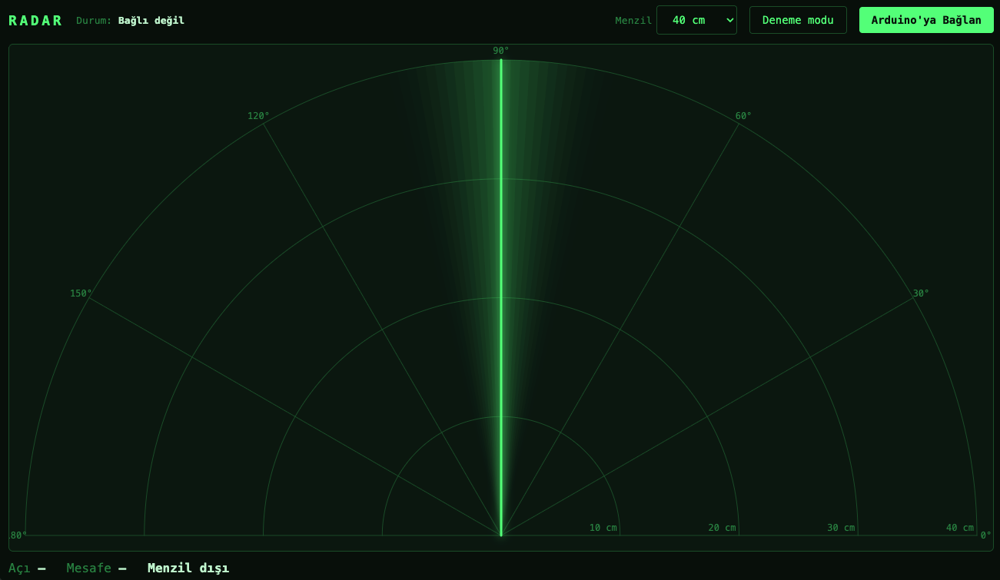
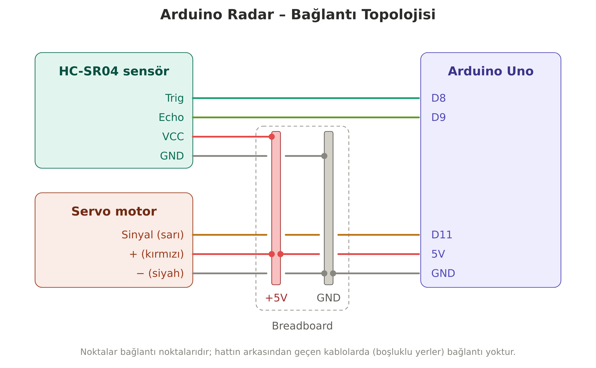

# Arduino Radar Sistemi

Arduino Uno, HC-SR04 ultrasonik mesafe sensörü ve bir servo motorla yapılmış basit bir radar. Servo motor sensörü 15° ile 165° arasında sağa sola çevirir. Sensör her açıda önündeki cisme olan mesafeyi ölçer, Arduino da bu bilgiyi USB üzerinden bilgisayara gönderir. Bilgisayar tarafındaki program bu verileri yeşil bir radar ekranında gösterir; algılanan cisimler kırmızı çizgiyle işaretlenir.



## Malzemeler

| Malzeme | Adet |
|---|---|
| Arduino Uno | 1 |
| HC-SR04 ultrasonik mesafe sensörü | 1 |
| SG90 (veya benzeri) servo motor | 1 |
| Breadboard | 1 |
| Jumper kablo | ~10 |
| USB kablosu (Arduino için) | 1 |

## Bağlantılar



| Parça | Pin | Arduino |
|---|---|---|
| HC-SR04 | Trig | D8 |
| HC-SR04 | Echo | D9 |
| HC-SR04 | VCC | 5V (breadboard + hattı) |
| HC-SR04 | GND | GND (breadboard − hattı) |
| Servo | Sinyal (sarı/turuncu) | D11 |
| Servo | + (kırmızı) | 5V (breadboard + hattı) |
| Servo | − (siyah/kahverengi) | GND (breadboard − hattı) |

Arduino'nun 5V ve GND pinleri breadboard'un güç hatlarına bağlanır; sensör ve servo gücünü bu hatlardan alır.

## Dosyalar

| Dosya | Açıklama |
|---|---|
| `radar_arduino.ino` | Arduino'ya yüklenen kod. Servoyu döndürür, mesafeyi ölçer ve veriyi bilgisayara gönderir. |
| `radar.html` | Tarayıcıda çalışan radar ekranı. Ek program kurmak gerekmez. |
| `Radar.pde` | Processing ile çalışan radar ekranı (alternatif). |
| `Radar_Topoloji.png` | Bağlantı şeması. |
| `radar_ekran.png` | Radar ekranının görüntüsü. |

## Kurulum

Kurulum iki adımdan oluşur: önce kodu Arduino'ya yüklersin, sonra bilgisayarda radar ekranını açarsın.

### 1. Arduino kodunu yükle

1. [Arduino IDE](https://www.arduino.cc/en/software)'yi indirip kur.
2. Bu depodan `radar_arduino.ino` dosyasını indir.
3. Dosyaya çift tıklayarak Arduino IDE'de aç. IDE dosyayı aynı adlı bir klasöre taşımak isterse **Tamam** de.
4. Arduino'yu USB kablosuyla bilgisayara tak.
5. **Araçlar → Kart** menüsünden **Arduino Uno**'yu seç.
6. **Araçlar → Port** menüsünden Arduino'nun bağlı olduğu portu seç. Windows'ta `COM3`, `COM4` gibi, Mac'te `/dev/cu.usbmodem...` gibi görünür.
7. Sol üstteki **Yükle (→)** butonuna bas. Altta "Yükleme tamamlandı" yazısı çıkınca işlem biter.
8. Servo motor sağa sola dönmeye başlar.

Kod, Arduino IDE ile birlikte gelen `Servo` kütüphanesini kullanır; ayrıca kütüphane kurman gerekmez.

> Arduino yüklenen kodu elektrik aldığı sürece çalıştırır. Durdurmak için USB kablosunu çıkarabilirsin. Tekrar taktığında kod kendiliğinden yeniden başlar.

### 2. Radar ekranını aç

Radar ekranı için iki seçenek var; ikisi de aynı işi yapar. Hangisini kullanırsan kullan, önce **Arduino IDE'yi kapat**. Aynı anda yalnızca bir program Arduino'ya bağlanabilir.

#### Seçenek A: Tarayıcı (`radar.html`), önerilen

1. Bu depodan `radar.html` dosyasını indir.
2. Dosyayı **Google Chrome** veya **Microsoft Edge** ile aç (dosyaya sağ tıklayıp **Birlikte aç** menüsünden seçebilirsin). Safari ve Firefox USB bağlantısını desteklemez.
3. Sağ üstteki **Arduino'ya Bağlan** butonuna bas.
4. Açılan pencerede Arduino'yu seç (adında "Arduino Uno", "usbmodem" ya da "COM" geçer) ve **Bağlan**'a tıkla.
5. Yeşil tarama çizgisi dönmeye başlar. Sensörün önüne bir cisim koyduğunda o yönde kırmızı çizgi görünür.

Ek özellikler:

- **Menzil** kutusundan radarın gösterdiği en uzak mesafeyi (20, 40, 100 veya 200 cm) seçebilirsin.
- **Deneme modu** butonu Arduino olmadan sahte verilerle radarı çalıştırır.

#### Seçenek B: Processing (`Radar.pde`)

1. [Processing](https://processing.org/download)'i indirip kur.
2. Bilgisayarında `Radar` adında bir klasör oluştur ve `Radar.pde` dosyasını bu klasörün içine koy. Processing, dosyanın kendi adını taşıyan bir klasörde durmasını ister.
3. `Radar.pde` dosyasına çift tıklayarak Processing'de aç.
4. Sol üstteki **Çalıştır (▶)** butonuna bas.
5. Program Arduino'nun portunu otomatik bulmaya çalışır ve radar penceresini açar. Alttaki konsolda hangi porta bağlandığı yazar.

Programı kapatmak için **Durdur (■)** butonuna bas ya da radar penceresini kapat.

## Nasıl çalışır?

HC-SR04 sensörü bir ses dalgası gönderir ve dalganın bir cisme çarpıp geri dönmesi için geçen süreyi ölçer. Mesafe şu formülle hesaplanır:

```
mesafe (cm) = süre (µs) × 0.034 / 2
```

Ses havada yaklaşık 0.034 cm/µs hızla ilerler; dalga gidip geri döndüğü için sonuç ikiye bölünür.

Arduino her ölçümü seri port üzerinden (9600 baud) `açı,mesafe.` formatında gönderir, örneğin `90,25.`. Radar ekranı bu veriyi okuyup çizer.

## Sorun giderme

| Sorun | Çözüm |
|---|---|
| Arduino IDE'de port görünmüyor | USB kablosunu çıkarıp tekrar tak. Kablonun veri aktarımını desteklediğinden emin ol (bazı kablolar sadece şarj içindir). |
| Servo dönmüyor | Kabloları ve 5V/GND bağlantısını kontrol et. Kodun yüklendiğinden emin ol. |
| Radar ekranında çizgi hareket etmiyor | Arduino IDE ve Seri Port Ekranı'nı kapat, radar programını yeniden başlat. |
| `radar.html` "tarayıcı desteklemiyor" diyor | Dosyayı Chrome veya Edge ile aç. |
| Processing "port busy" hatası veriyor | Arduino'ya bağlı başka bir program açık; onu kapat. |
| Processing yanlış porta bağlanıyor | `Radar.pde` içinde konsolda listelenen portlardan doğrusunu seçecek şekilde `secilen` değişkenini düzenle. |
| Mesafe hep 0 veya "Menzil dışı" | Trig ve Echo kablolarının D8 ve D9'a doğru takıldığını kontrol et. |
